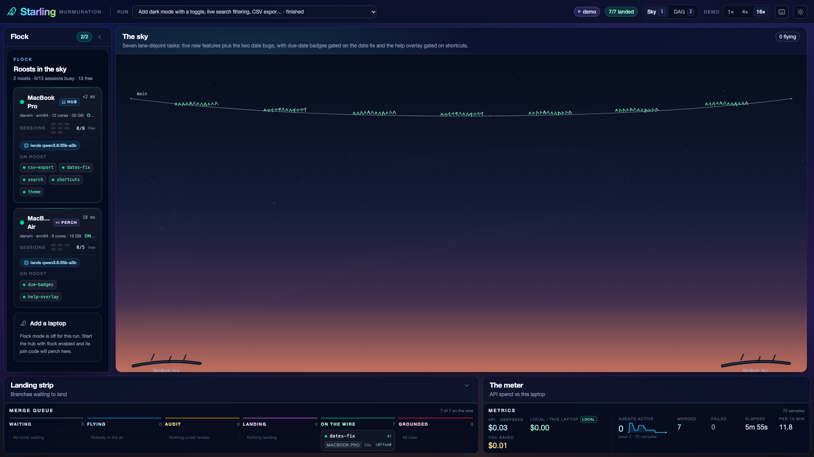
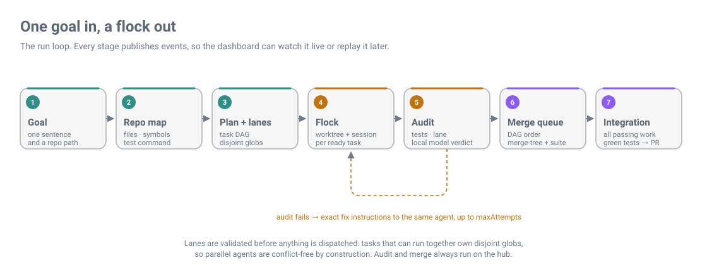
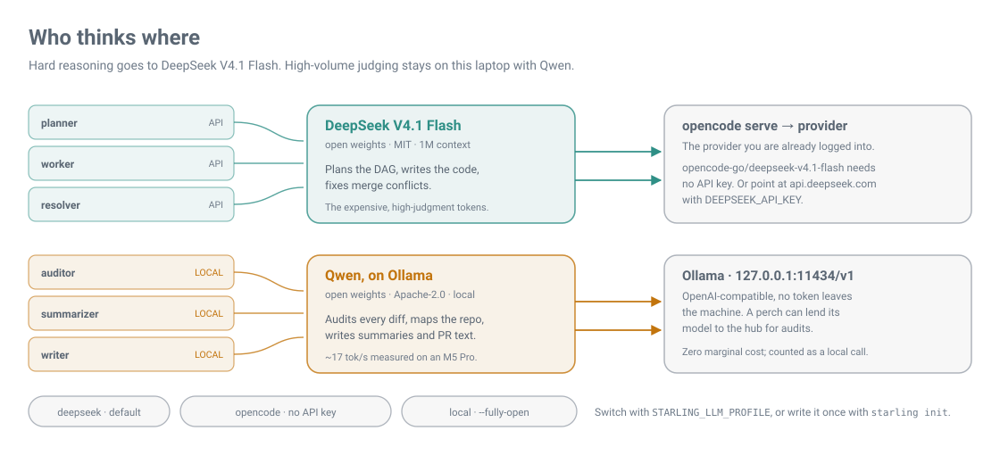
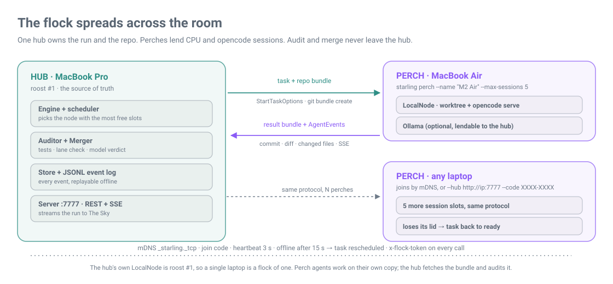

<div align="center">

# 🐦 Starling

**One goal in, a murmuration of open-weight coding agents out.**

[](https://github.com/broiisapro/starling/actions/workflows/ci.yml)
[](LICENSE)
[](https://hacktoberfest.com)
[](https://bun.sh)

[Quickstart](#quickstart) · [How it works](#how-it-works) · [Model routing](#model-routing) · [Flock mode](#flock-mode) · [Agent Skill](#use-it-from-your-agent) · [Architecture](#architecture) · [Contributing](#contributing)

</div>



Starling takes one sentence like *"add dark mode, live search, CSV export and fix the two date bugs"* and turns
it into a **task DAG with non-overlapping file lanes**. It runs each task in its own git worktree and opencode
session, audits every result with tests plus a local open-weight model, and merges the passing work onto **one
integration branch** — on this laptop, and on every other laptop on the network that runs `starling perch`.

Open source, MIT, open-weight first. Built on [opencode](https://opencode.ai).

> **Status: v0.1 preview.** Every package — planner, workspace, runner, auditor, merger, store, engine, flock,
> perch, server, dashboard — is implemented and tested. The CLI still boots a **mock composition**, so
> `starling run` today exercises the whole experience over a scripted run. Real engine and flock wiring lands
> in v0.1. Commands in this README were run against this checkout; anything not wired yet is marked ⏳.

## Why

Running several coding agents at once is normal now. Doing it *well* is not.

1. **Humans still do the decomposition.** Most tools leave "split this into parallel tasks" to you.
2. **Parallel agents collide.** Two agents edit the same file, and a human untangles the merge.
3. **Nobody checks the work.** "Done" means whatever the agent says it did.
4. **They are built around closed frontier models.** Open weights are an afterthought, and a fleet on paid
   models is expensive.

Starling fixes the decomposition with **lanes**, makes collisions structural rather than accidental, audits
every task before it can land, and routes the cheap high-volume work to a model running on your own machine.

## How it works



1. **Map.** Scan the repo into a compact map: files, symbols, test and lint commands. A local model can
   summarise the unfamiliar parts.
2. **Plan into lanes.** DeepSeek V4.1 Flash turns the goal into a task DAG. Every task carries a **lane**: the
   globs it may write. The planner validates the DAG and refuses to dispatch when two tasks that can run at the
   same time own the same globs.
3. **Launch the flock.** Each ready task gets a branch, a git worktree and an opencode session, with a prompt
   compiled from the goal, deliverables, out-of-scope list and a literal definition of done.
4. **Audit locally.** When an agent goes idle, Starling runs the tests, checks lane violations, and has a local
   Qwen model judge the diff against the definition of done. A failure goes back to the same agent with exact
   fix instructions, up to `maxAttempts`.
5. **Merge queue.** Passing branches merge in DAG order onto `starling/<run>/integration`. `git merge-tree`
   predicts conflicts, and the regression suite runs after each merge.
6. **Watch the sky.** Every transition is a `StarlingEvent`: persisted, streamed over SSE, and drawn as a
   murmuration where each task is a bird that takes off, circles while it is audited, and lands on the wire.

## Quickstart

**Prerequisites:** [Bun](https://bun.sh) 1.4.4 (1.3+ works), Git 2.38+, and
[opencode](https://opencode.ai) if you want real agent sessions. Ollama powers the default local auditor;
without it, point `models.auditor` at a provider you do have. Windows is not supported yet.

Starling is not on npm yet. Run it from a checkout:

```bash
git clone https://github.com/broiisapro/starling.git
cd starling
bun install
```

Check the machine before you fly it:

```bash
bun run starling doctor
```

```text
Starling doctor  ·  darwin/arm64 · bun 1.4.4

✔ bun       1.4.4 (needs ≥ 1.3)
✔ git       2.54.0 (needs ≥ 2.38)
✔ opencode  opencode v2.1.2
✔ deepseek  opencode-go/deepseek-v4.1-flash (any provider is fine)
✔ config    defaults (no starling.config.yaml yet — run `starling init`)
✔ ollama    reachable at http://127.0.0.1:11434/api/tags · 1 local model
! ram       1.3 GB free of 32 GB — tight for a big flock
            hint: close unused apps or lower maxParallel

✔ 7 ok  ·  ✘ 0 failed  ·  ! 1 warning
Ready to fly. 🐦
```

Write a config for your machine (it detects whether you have an opencode login, a DeepSeek key, or only
Ollama):

```bash
bun run starling init
# ✔ wrote starling.config.yaml  profile opencode-go
```

Then plan — read-only: no agents, no worktrees, no spend.

```bash
bun run starling plan "add CSV export and fix the overdue date bug" --repo examples/sky-todo
```

```text
Starling plan  ·  5 tasks  ·  deepseek/deepseek-v4.1-flash

TASK           TITLE                              DEPENDS      OWNS                     EST
  survey       Survey the repo and lock the plan  —            notes/**                 4m
  core-change  Make the core change               survey       src/core/**, src/lib/**  14m
  tests        Add regression tests               core-change  test/**                  8m
  docs         Document the change                core-change  docs/**                  5m
  polish       Polish the edges                   tests, docs  src/ui/**                6m

✔ No issues — the DAG is ready to fly.
```

*(Output trimmed. ⏳ The real planner is wired in v0.1; today this comes from the mock composition.)*

Dry-run the whole engine, then launch it:

```bash
bun run starling run "add CSV export and fix the overdue date bug" --repo examples/sky-todo --dry-run
bun run starling run "add CSV export and fix the overdue date bug" --repo examples/sky-todo \
  --max-parallel 8 --record run.jsonl
```

```text
✔ run finished in 1.5s
✔ 5 merged  ·  ✘ 0 failed  ·  0 conflicts
api $0.004  ·  local $0  ·  saved $0.002
branch starling/zqpmky/integration
recorded 76 events → run.jsonl
```

Open the dashboard in two terminals (⏳ `starling dash` boots both for you in v0.1):

```bash
bun run dev:server   # REST + SSE on :7777
bun run dev:web      # The Sky on http://localhost:5173
```

No server? `http://localhost:5173/?demo=1` plays the recorded launch-day run straight from the bundle.

To drop the `bun run` prefix:

```bash
alias starling='bun run --cwd /path/to/starling starling'
```

### Other commands

| Command | What it does | State |
| --- | --- | --- |
| `starling plan "<goal>" --repo .` | map the repo, print the DAG and lane matrix | ✅ runs (mock plan until v0.1) |
| `starling run "<goal>"` | plan, dispatch, audit, merge, live view | ✅ runs (mock composition until v0.1) |
| `starling run "<goal>" --dry-run` | stop after a validated plan | ✅ |
| `starling run "<goal>" --record run.jsonl` | record every event for replay | ✅ |
| `starling status [runId]` / `--file run.jsonl` | run summary from the store or a recording | ✅ |
| `starling replay <file.jsonl> --speed 4` | replay a recorded run with original timing | ✅ |
| `starling flock` | list roosts and print the join command | ✅ mock roster (real hub in v0.1) |
| `starling perch` | join a hub from another laptop | ⏳ v0.1 |
| `starling dash` | serve the dashboard | ⏳ v0.1 (two-terminal workaround above) |
| `starling run --github` | plan → issues, task → PRs | ⏳ v0.1 |
| `starling run --fully-open` | every role on local models | ⏳ v0.1 |

## Model routing

Starling is open-weight first, and its default route keeps the expensive reasoning and the high-volume judging
on different machines.



| Role | Default model | Where | Why |
| --- | --- | --- | --- |
| `planner` | DeepSeek V4.1 Flash | API or opencode | hard reasoning, 1M context, structured JSON |
| `worker` | DeepSeek V4.1 Flash | inside opencode | strong agentic coding |
| `resolver` | DeepSeek V4.1 Flash | inside opencode | merge conflicts are real coding |
| `auditor` | Qwen (config default `qwen3.6:35b-a3b`) | Ollama, local | a verdict per task, zero marginal cost |
| `summarizer` | Qwen | Ollama, local | repo-map file summaries, cached |
| `writer` | Qwen | Ollama, local | PR bodies, commit messages, run summaries |

Measured on the M5 Pro: `qwen3.8:27b-mlx` audits at ~17 tok/s and fits beside opencode sessions
(`docs/epic-28-local-bench.md`). Swap models in `starling.config.yaml`; the auditor is deliberately not the
same model as the worker.

Three routing profiles, selected with `STARLING_LLM_PROFILE`:

| Profile | Effect |
| --- | --- |
| `deepseek` (default) | config as written: build roles on DeepSeek, judging roles on Ollama |
| `opencode` | every role through your local `opencode serve` and the provider you are logged into — **no API key needed** |
| `local` | every role on Ollama (`--fully-open`, ⏳ v0.1): nothing leaves the laptop |

The cost meter counts API spend and local calls separately, and reports the estimated dollars saved by
running the auditor on your own hardware.

## Flock mode

One process is the **hub**. Any other laptop on the LAN can become a **perch** and lend its CPU and opencode
sessions. The repo travels as a git bundle, results come back as a bundle, and audit plus merge stay on the
hub.



```bash
# laptop 1 — the hub
bun run starling run "add dark mode and CSV export" --repo ./my-app
bun run starling flock                 # prints the join command + code

# laptop 2 — a perch (⏳ CLI wiring in v0.1)
bun run starling perch --hub http://192.168.1.20:7777 --code STAR-LING \
  --name "M2 Air" --max-sessions 5
```

- **Discovery:** mDNS (`_starling._tcp`) when the wifi allows multicast; `--hub` + `--code` always works.
- **Scheduling:** the hub picks the node with the most free session slots, then lowest latency, then itself.
- **Auth:** every hub ↔ perch call carries the join code in `x-flock-token`. LAN only, no TLS.
- **Failure:** heartbeats every 3 s; a perch missing for 15 s is offline and its running tasks go back to
  `ready` and are rescheduled. Nothing is lost.
- **Lending models:** a perch with Ollama can lend it to the hub, so one laptop's auditor serves the flock.

## Use it from your agent

Starling ships as a standard [Agent Skill](https://agentskills.io), so opencode or Claude Code can hand it a
multi-part goal instead of grinding through it serially.

```bash
integrations/opencode/install.sh --project    # .opencode/ in this repo
integrations/opencode/install.sh --global     # ~/.config/opencode/
integrations/opencode/install.sh --dir ~/.claude   # Claude Code
```

Then, in the agent:

```text
/swarm Add dark mode, live search, CSV export and fix the two date bugs
```

The skill plans first, shows you the lanes, stops on any validation issue, and only launches after you
approve. It also teaches the agent to report by exception and to end with the integration branch, not with
"the agents went idle". See [`skills/starling/SKILL.md`](skills/starling/SKILL.md).

## Demo and replay

Every run can be recorded and replayed event-for-event, with its original timing, no network and no model:

```bash
bun run starling replay fixtures/runs/sky-todo-launch-day.jsonl --speed 4
```

The bundled launch-day recording is a seven-task run on
[`examples/sky-todo`](examples/sky-todo) — a real little app with deliberately disjoint feature folders so
lanes are genuinely parallel. The dashboard falls back to the same events with `?demo=1`, which is the demo
safety net when conference wifi dies.

## Architecture

```
apps/cli · apps/server · apps/web
        │
packages/engine ──► ports from packages/core
        │
planner · prompts · workspace · auditor · merger · store
runner · flock · perch · github · repomap · llm
```

| Package | One line |
| --- | --- |
| `@starling/core` | contracts, zod schemas, ports, config, event bus, ids, errors, test doubles |
| `@starling/llm` | model router, DeepSeek/Ollama/opencode providers, structured output, cost meter |
| `@starling/repomap` | repo scanner → compact `RepoMap` (files, symbols, commands) |
| `@starling/planner` | goal + map → task DAG with lanes, validator and auto-repair |
| `@starling/prompts` | worker, fixer and resolver prompt compiler |
| `@starling/workspace` | git worktrees, diffs, `merge-tree` conflict prediction |
| `@starling/runner` | opencode server client (`AgentRunner`) plus replay/mock runners |
| `@starling/auditor` | tests + lane check + model verdict against the definition of done |
| `@starling/merger` | merge queue onto the integration branch, with a test gate |
| `@starling/github` | issues and PRs through the `gh` CLI (optional) |
| `@starling/store` | `bun:sqlite` runs + JSONL event log, record/replay |
| `@starling/engine` | the orchestration state machine; talks only to ports |
| `@starling/flock` | `LocalNode`/`RemoteNode`, registry, capacity scheduler, mDNS |
| `@starling/perch` | the `starling perch` daemon: Perch HTTP API over a `LocalNode` |
| `apps/server` | Hono REST + SSE (`:7777`), serves the web build in production |
| `apps/cli` | the `starling` binary: plan, run, replay, dash, perch, flock, status, doctor, init |
| `apps/web` | The Sky: murmuration, DAG, agent drawer, merge queue, cost meter |
| `skills/starling` | Agent Skill + `/swarm` command for opencode and Claude Code |
| `evals`, `tools/local-models` | planner/auditor evals; local-model benchmark and setup |
| `examples/sky-todo` | the demo target app (its own project, not part of the workspace) |

Contracts and ports are locked in [`packages/core`](packages/core/src/contracts.ts). The engine never imports
a sibling package; it talks to `ExecutionNode`, `Workspace`, `LLM`, `Auditor`, `Merger` and friends, which is
why every piece is testable with fakes and why a perch is just another `ExecutionNode`.

## Built by the flock

Starling was built the way it works.

About 35 DeepSeek agents ran in parallel **lanes** across two laptops (an M5 Pro and an M2 Air), each from a
compiled epic prompt, each in its own git worktree, each audited before merge. Root contracts were frozen
before the swarm started, lanes were disjoint by construction, and every PR came with a handback: what
landed, what was verified, what was deliberately deferred. The GitHub PR graph is the real artifact — this
repo is the dogfood run.

| Waves | Epics | Agents | Laptops | PRs |
| --- | --- | --- | --- | --- |
| 3 waves + 1 checkpoint | ~60 | ~35 | 2 | see the graph |

*Live numbers (epics, PRs, commits, lines, test counts, agent-hours) land with the built-by-the-flock stats
tool, coming in v0.2.*

## Roadmap

- **v0.1** — real engine and flock wiring in the CLI; one-command `starling dash`; `starling perch` join;
  GitHub issues/PRs; conflict resolver; fully-open local workers.
- **v0.2** — bench-tuned auditor per laptop; launch-a-run form; built-by-the-flock stats page; landing site.
- **Later** — more agent CLIs behind `AgentRunner`; Windows via WSL; hosted hub; release automation.

## Contributing

Lanes are how this project stays mergeable, and they are also how you can help without stepping on anyone.
Read [`CONTRIBUTING.md`](CONTRIBUTING.md) for setup, the lane rules, the handback format and the AI-contributor
rules in [`AGENTS.md`](AGENTS.md).

Good first issues are labelled and kept small: `gh issue list --label good-first-issue`.

## License

[MIT](LICENSE) © Moksh. Starling is a Hacktoberfest project; bird puns in PRs are welcome but optional. 🐦
