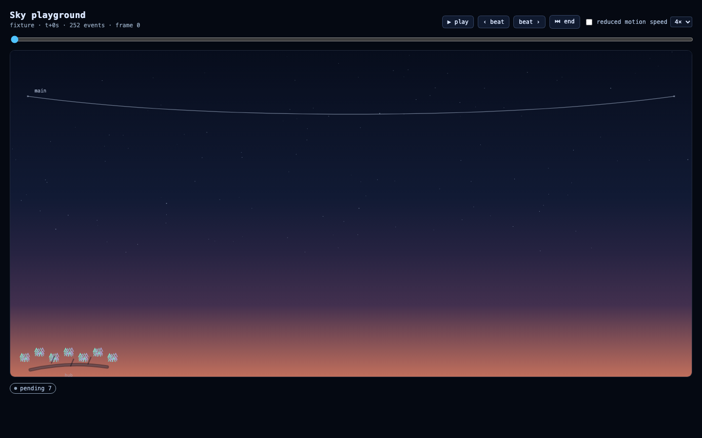
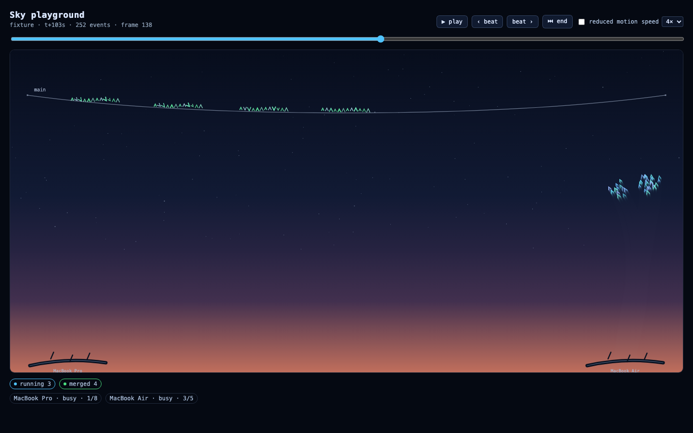
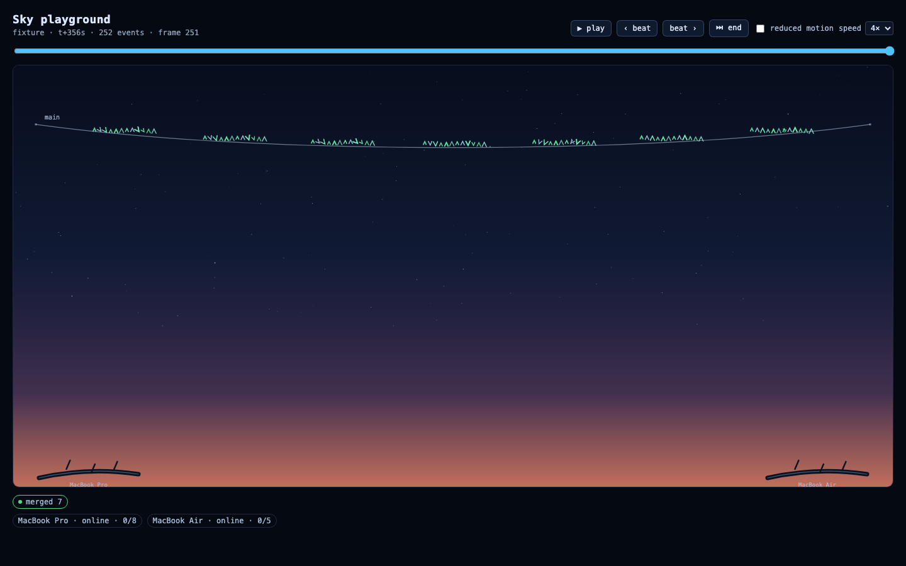

# Epic 24 — Web: the Sky murmuration

## Goal

Build **the Sky**: the dashboard panel that makes Starling legible at a glance. Every task is a
flock of twelve starlings, every machine is a roost, and `main` is a telephone wire birds land on
when their work merges. A run reads as a murmuration: work-in-flight swirls above its machine, audits
tighten into amber circles, fixers zig-zag coral, conflicts flicker, failures fall, and merged work
settles left-to-right along the wire. When a laptop drops off the flock, its roost dims and its birds
scatter; when a task migrates, the flock flies the long arc to its new roost with a trail behind it.

The panel is driven purely by `SkyViewProps` (ARCHITECTURE §8), so it is identical under live SSE,
a replay, or the recorded fixture. It ships with a Playground page (scrubber, beat-stepping,
play/pause) and committed screenshots of the fixture at t=0, mid-run, the end, calm mode and hover.





## How it works

```
SkyViewProps ──► SkySimulation.setInput() ──► step(dt) ──► birds (Float32Array ×5)
                       │                         │                    │
                 behaviour.ts               boids.ts            render.ts
                 (status → kind)      (separation/alignment/     (Canvas 2D,
                                       cohesion + formation)      trails, chrome)
```

**Files** (all under `apps/web/src/features/sky/`):

| File | Role |
|---|---|
| `handshake.ts` | Verbatim mirror of the §8 `SkyViewProps` interface. |
| `palette.ts` | Local fallback status colours (same keys as the future `lib/status.ts`) + 12 pre-blended iridescent stroke colours per status. |
| `behaviour.ts` | The documented status → behaviour table, `STATIC_KINDS`, and the `migrate`/`scatter` overrides. |
| `layout.ts` | Pure geometry: catenary wire, roost placement (locals left, perches right), perch offsets, calm zones. |
| `boids.ts` | Allocation-free boids maths: separation/alignment/cohesion + per-behaviour formation offsets, static placement. |
| `calm.ts` | Reduced-motion layout: each flock parks in its state zone, or on its roost/wire slot. |
| `sim.ts` | `SkySimulation`: input diffing, status → behaviour transitions, leader choreography, migration, node churn, activity, hit testing. |
| `render.ts` | `createSkyRenderer`: DPR + ResizeObserver, gradient painted once offscreen, motion-trail layer, chevrons, wire/roost/label/halo chrome. |
| `replay.ts` | JSONL parsing and `buildFrame(events, i)` — the fixture reducer used by the Playground. |
| `SkyView.tsx` | The panel: one rAF loop, pointer/keyboard interaction, tooltip, live region, reduced motion. |
| `Playground.tsx` | Dev page: fixture or file input, scrubber, play/pause, speed, beat stepping, reduced motion toggle. |
| `preview.html` / `preview.tsx` | Vite dev entry (`/src/features/sky/preview.html?t=0|mid|end|<seconds>&calm=1`) that bundles the fixture with `?raw` — the offline demo backup and the source of the screenshots. |

**State → behaviour** (the table in `behaviour.ts`, reproduced for reviewers):

| Status | Kind | What it does |
|---|---|---|
| `pending` | perched | still on its node's roost, two-height crowd, slow bob |
| `ready` | hopping | short hops along the branch |
| `running` | murmur | wide loop above its roost; radius and speed scale with agent activity |
| `auditing` | circle | tight amber circle |
| `fixing` | zigzag | fast coral zig-zag |
| `merging` | glide | cubic-eased glide to its wire slot |
| `merged` | wirePerch | perched on `main` in merge order, gentle sway |
| `conflict` | flicker | two sub-flocks blinking against each other |
| `failed` | fall | slow fall, greys and thins out |
| `cancelled` | fade | drifts apart and fades to nothing |

`migrate` (a `task.migrated` event, or a `nodeId` change) overrides the status behaviour for a 3.4 s
quadratic-bezier arc between the two roosts, recording a 48-point breadcrumb trail that fades once the
arc completes. `scatter` overrides for 1.5 s when a node leaves, pushing its birds outward.

**What the fixture looks like** (screenshots in `__screens__/`):

- **t=0** (`sky-t0.png`, frame 0): only `run.created` has landed, so there are no nodes yet. Seven
  pending flocks perch on a placeholder hub branch; the wire is empty; the legend says `pending 7`.
- **mid-run** (`sky-mid.png`, t+103 s, frame 138): four merged flocks sit along the wire in merge
  order (green), three running flocks murmur above the Air (cyan), and both branches are labelled
  `MacBook Pro` / `MacBook Air`; the legend reads `running 3`, `merged 4`, `MacBook Air · busy · 3/5`.
- **end** (`sky-end.png`, t+356 s, frame 251): all seven flocks are on the wire in merge order, both
  machines are online and idle, and the only legend chip left is `merged 7`.
- **calm** (`sky-calm.png`): reduced motion parks the four merged flocks on the wire and the three
  running flocks in the running band — a static status map, no flocking.
- **hover / selected** (`sky-hover.png`, `sky-selected.png`): hovering the first merged flock shows
  the canvas key label `theme` plus a DOM tooltip (`Dark mode with a toggle`, `merged`, `MacBook Pro`,
  `attempt 1`); clicking draws a pulsing halo and sets `selected theme` in the footer.

## Key decisions & reasoning

- **Simulation, renderer and state are three layers.** `sim.ts` has no DOM and no timers, so
  determinism, migrations and reduced-motion layout are testable in bun at full speed. `render.ts`
  owns every pixel and every browser API. `SkyView` only wires props → sim → renderer.
- **Analytic leader choreography, boid birds.** Leader targets come from closed-form paths (orbit,
  circle, zig-zag, bezier glide, migration arc) with exponential smoothing; the twelve birds do the
  separation/alignment/cohesion. This is predictable and cheap, and it makes "auditing is tight,
  running is wide" an assertion rather than a hope.
- **Still means still.** `perched`, `hopping`, `wirePerch` and `fall` place birds directly (with a
  deterministic bob/sway) instead of integrating forces. Perched birds do not jitter, merged birds
  hold their wire slot, and the state is exactly reproducible.
- **Wire slots are claimed at `merging`, not `merged`,** so the glide always has a target. Slots are
  spaced by the *expected* number of tasks, so a flock does not jump sideways every time another
  merge lands; the left-to-right order is the merge order.
- **Migrations are triggered twice, deduped once.** Both `task.migrated` events and a `nodeId` diff
  start the arc; `startMigration` ignores a second request for the same target node, so a live feed
  and a replay behave the same.
- **Activity is per-task and decays between prop updates.** `agent.event` timestamps are kept per task
  (last 120), and the "now" clock is extrapolated from the last input, so a flock stops flying hard
  ten seconds after the last tool call without needing another event to arrive.
- **Roosts never vanish on `node.left`.** Departed nodes keep a dimmed roost (the branch dims, grow
  stops) so the scatter is visible; a returning node re-grows its roost with a glow.
- **A placeholder hub roost exists before the first join.** Frame 0 of the fixture has no nodes; the
  hub is the one machine guaranteed to exist, so pending birds get a branch instead of perching in
  mid-air. The real hub replaces it a second later.
- **Two canvases, no per-frame allocations.** The dusk gradient and star field are painted once per
  resize; a trail layer is faded with `destination-out` and composited; chrome and labels are drawn
  fresh on top so they never smear. Bird strokes come from 12 pre-blended colours per status, and the
  hot loops only touch `Float32Array`s.
- **Reduced motion is a layout, not a slowdown.** `/` parks each flock in its state zone and stops
  stepping entirely (the loop draws only on a dirty flag). `reducedMotion === true` or the
  `prefers-reduced-motion` media query both enable it; the OS preference wins over `false`.
- **Interaction without a store.** `SkyView` reads only its props. Hit-testing is nearest-leader
  within 54 CSS px; arrow keys cycle the selection for keyboard users; the tooltip is a DOM overlay
  (crisper text, screen-reader friendly) while the on-canvas label is drawn by the renderer.
- **Accessibility is visible, not an afterthought.** The wrapper is `role="application"` with a
  roledescription and a live count label; the canvas is focusable with an instruction label; a
  visually hidden `aria-live="polite"` region narrates `describeSky(run, nodes)` on every change.
- **The Playground is a reducer, not a second store.** `buildFrame(events, i)` rebuilds the world
  from index 0 every time, so backwards scrubbing is exact. Manual scrubs remount `SkyView` (new sim)
  to reset merge slots and wing state; playback advances a wall-clock playhead, not an event counter.
- **The fixture page is self-contained.** `preview.tsx` imports the fixture with `?raw`, so the demo
  backup needs no server, no API and no network; `Playground`'s fetch path and file picker cover the
  dashboard case.
- **No `zod` in the browser bundle.** `@starling/core`'s barrel imports `config.ts` → `node:fs` →
  Vite cannot bundle it. `replay.ts` therefore validates the event envelope structurally and leaves
  deep payload validation to the server/data layer (see the CONTRACT REQUEST in the handback). All
  other core imports in this lane are `import type` and disappear at build time.

## Interfaces for future epics

The lane's public surface is `apps/web/src/features/sky/index.ts`. Exact signatures:

```ts
// feature props (mirrored verbatim from ARCHITECTURE §8 in handshake.ts)
export interface SkyViewProps {
  run?: Run;
  nodes: NodeInfo[];
  recent: StarlingEvent[];
  selectedTask?: string;
  onSelectTask(key: string): void;
  reducedMotion?: boolean;
}
export function SkyView(props: SkyViewProps): ReactElement;

// dev page + demo backup
export interface PlaygroundProps {
  events?: readonly StarlingEvent[];
  src?: string;
  initialIndex?: number;
  autoPlay?: boolean;
  initialCalm?: boolean;
}
export function Playground(props: PlaygroundProps): ReactElement;
export const DEFAULT_FIXTURE_URL = '/fixtures/runs/sky-todo-launch-day.jsonl';

// simulation (pure, no DOM — usable in scripts, tests and evals)
export function createSky(opts: SkySimOptions): SkySimulation;
export interface SkySimOptions { width: number; height: number; seed?: number; reducedMotion?: boolean }
export interface SkyInput {
  runId?: string;
  plan?: Plan;
  tasks?: Record<string, TaskRun>;
  nodes: readonly NodeInfo[];
  recent?: readonly StarlingEvent[];
  now?: number;
}
export class SkySimulation {
  width: number; height: number; wire: Wire;
  birds: BoidBuffers;                 // { x, y, vx, vy, phase: Float32Array }
  flocks: Flock[]; roosts: Roost[]; simTime: number; reducedMotion: boolean;
  setInput(input: SkyInput): void;
  resize(width: number, height: number): void;
  setReducedMotion(on: boolean): void;
  step(dt: number): void;
  findFlock(taskKey: string): Flock | undefined;
  hitTest(x: number, y: number, radius?: number): string | undefined;
  countsByStatus(): Record<TaskStatus, number>;
  wallNow(): number;
  layoutCalm(): void;
}
export const BIRDS_PER_FLOCK = 12;
export const MAX_TASKS = 30;
export const MAX_BIRDS = 360;
export function hashSeed(seed: number | string): number;
export function mulberry32(seed: number): () => number;

// behaviour + colours (E23 can share these)
export type BehaviourKind = 'perched' | 'hopping' | 'murmur' | 'circle' | 'zigzag' | 'glide'
  | 'wirePerch' | 'fall' | 'flicker' | 'fade' | 'migrate' | 'scatter';
export interface Behaviour { kind: BehaviourKind; speed: number; spread: number; trail: boolean; alpha: number; tint: string }
export function behaviourFor(status: TaskStatus): Behaviour;
export function behaviourTable(): Readonly<Record<TaskStatus, Behaviour>>;
export const STATIC_KINDS: ReadonlySet<BehaviourKind>;
export const FALLBACK_STATUS_COLORS: Record<TaskStatus, string>;
export function statusColor(status: TaskStatus): string;
export const TASK_STATUSES: readonly TaskStatus[];
export const STATUS_SHEEN: Record<TaskStatus, readonly string[]>;
export const SKY_COLORS: { /* zenith, midSky, horizon, ember, stars, wire, … */ };

// fixture / replay helpers (also useful to E22's demo backup and E25's metrics history)
export interface SkyFrame { run?: Run; nodes: NodeInfo[]; recent: StarlingEvent[]; index: number; ts: number }
export function parseEventJsonl(text: string): StarlingEvent[];
export function buildFrame(events: readonly StarlingEvent[], index: number, opts?: { windowMs?: number }): SkyFrame;
export function indexAtTs(events: readonly StarlingEvent[], ts: number): number;
export function nextBeat(events: readonly StarlingEvent[], from: number, direction: 1 | -1): number;
export function statusCounts(run: Run | undefined): Record<TaskStatus, number>;
export function describeSky(run: Run | undefined, nodes: readonly NodeInfo[]): string;

// renderer (only needed by alternate shells / screenshot harnesses)
export interface SkyRenderer { resize(width: number, height: number, dpr: number): void; draw(sim: SkySimulation, opts?: RenderOptions): void; dispose(): void }
export function createSkyRenderer(canvas: HTMLCanvasElement): SkyRenderer;
```

**Usage in the shell (E23):**

```tsx
import { SkyView } from '../features/sky';

// store → props. The Sky never reads the store itself.
export function SkyPanel() {
  const run = useSkyStore((s) => s.run);
  const nodes = useSkyStore((s) => s.nodes);
  const recent = useSkyStore((s) => s.recentEvents);   // last ~10 s is enough
  const selected = useSkyStore((s) => s.selectedTask);
  const selectTask = useSkyStore((s) => s.selectTask);
  return (
    <SkyView
      run={run}
      nodes={nodes}
      recent={recent}
      selectedTask={selected}
      onSelectTask={selectTask}
      reducedMotion={useSkyStore((s) => s.reducedMotion)}
    />
  );
}
```

**Fixture / demo backup:**

```tsx
import { Playground, parseEventJsonl } from '../features/sky';
const events = parseEventJsonl(text); // or <Playground src="/fixtures/runs/sky-todo-launch-day.jsonl" />
<Playground events={events} initialIndex={140} />;
```

**Status colours at C1:** swap `palette.statusColor()` for `src/lib/status.ts`'s exported map when it
lands. The rest of the feature calls `statusColor()` / `FALLBACK_STATUS_COLORS` only through
`behaviour.ts` and the tooltip, so it is a two-line change.

## Deviations from plan

- **`sim.ts` is ~714 lines**, above the ~300-line style target. The input diffing, status machine,
  leader choreography and node-churn rules are one cohesive state machine, and splitting the class
  across files needed more plumbing than it saved. The reduced-motion layout *was* extracted to
  `calm.ts`, and boids maths to `boids.ts`.
- **Event JSONL is validated structurally, not with `zod`.** Bundling `StarlingEventSchema` from the
  core barrel drags `node:fs` into the browser build (see CONTRACT REQUEST). Deep validation stays on
  the server where it belongs.
- **Tooltip is DOM, not canvas text.** Sharper type, selectable, screen-reader visible; the key label
  on hover is still drawn on the canvas as specified.
- **Extra dev entry** `preview.html` + `preview.tsx` inside the lane (the requested file list stopped
  at `Playground.tsx`). It exists so the fixture demo works offline and so screenshots are
  reproducible; it is not a route and adds nothing to the production bundle.
- **Placeholder hub roost** when the node list is empty (frame 0), so pending birds have a branch.
- **Merged slots are spaced by the expected task count**, not packed from the left, so positions are
  stable while merges arrive; left-to-right order is still merge order.
- **Playground remounts `SkyView` on manual scrub** (`key={epoch}`). The sim diffs props forwards; a
  full remount is the honest way to make backwards scrubbing exact.
- **Screenshots were captured with Playwright against the Vite dev page** rather than generated in a
  test. They are documentation, not assertions; the deterministic sim tests are the safety net.

## Known limitations / deferred

- **No resolver status.** The engine's conflict resolver is not a `TaskStatus`, so a resolver session
  looks like its parent status. `conflict` gets the two-flock flicker; a dedicated resolver animation
  is a Wave 2 idea if the contract ever grows a status.
- **Migration duration is fixed at 3.4 s** regardless of distance, and the arc is a single quadratic
  bezier. Long and short hops therefore have the same timing (deliberate: demos read better with a
  consistent beat).
- **Merged slots are not reclaimed.** If a run is scrubbed backwards in place, merged slots keep
  advancing; the Playground avoids it by remounting on scrub. A store-driven live view never goes
  backwards.
- **The renderer is not unit-tested.** happy-dom has no 2D context; visual behaviour is verified by
  the committed screenshots and by the deterministic sim tests. A pixel-diff harness is a Wave 2
  candidate.
- **No per-task labels at rest.** Only hover shows the key; labelling 30 flocks would turn the sky
  into a wall of text. The DAG panel is the place for always-on labels.
- **Not wired into the shell.** Epic 23 owns layout/routing and the store; this lane exports the panel
  and the props contract only.
- **No live test file.** Everything here is deterministic and DOM-only; no network, no opencode, no
  LLM. `*.live.test.ts` was not needed.
- **`calmZone('pending' | 'merged')` fractions are unused** (pending uses its roost, merged uses the
  wire); the table stays total so a future status cannot silently miss a zone.
- **`bun run check` is red on the base tree** because of pre-existing formatting/lint errors in
  `docs/epic-01-demo-target.md`, `docs/epic-02-repo-ops.md` and `tools/local-models/**` (reproduced on
  a pristine `origin/main` worktree). The Sky lane itself is biome-clean; see the handback.
