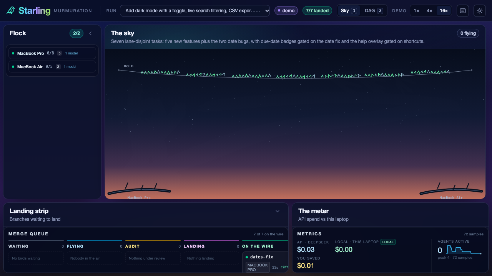
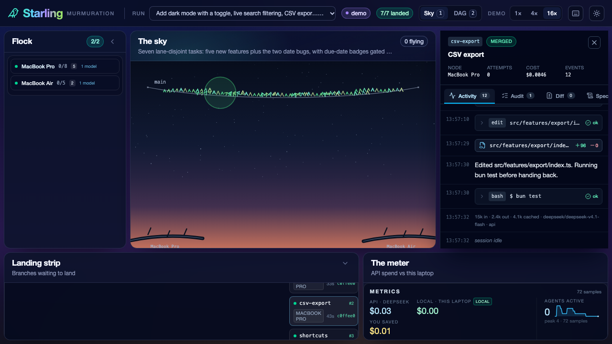
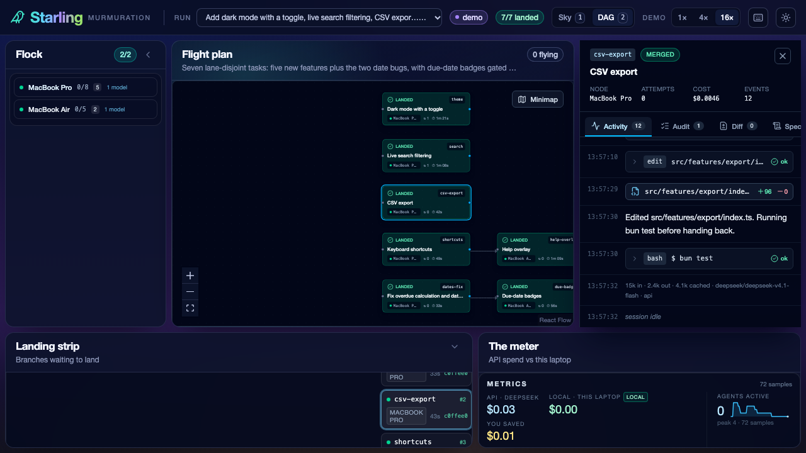
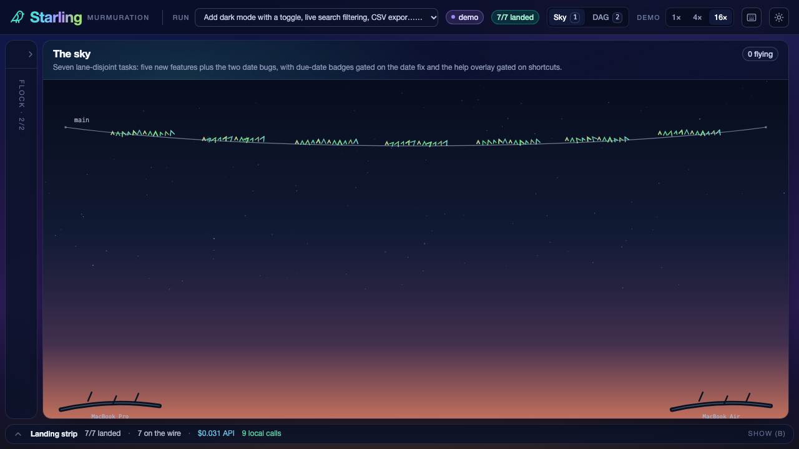
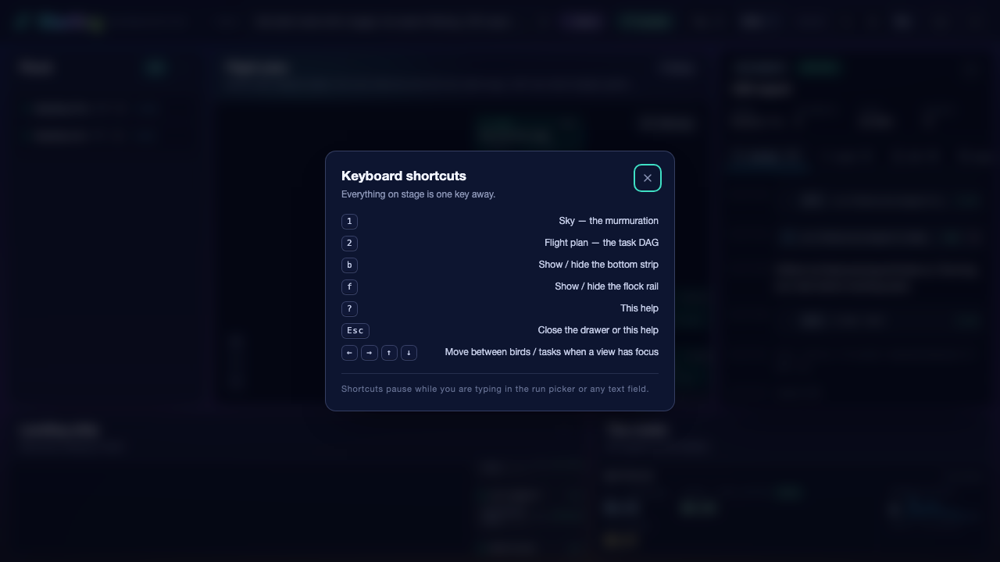

# Epic 34 (C1-b) — Wire the dashboard together

**Branch** `epic/34-c1-web-wiring` · **Sibling** Epic 33 (core consolidation, runs in parallel) ·
**Scope** `apps/web/src/{app,data,components,lib}`, `main.tsx`, `index.css`, `index.html`, plus four
named touch-ups inside `apps/web/src/features/*`

## Goal

Wave 1 shipped seven independent web pieces: the shell (regions, store, reducer, selectors, SSE,
demo player) and six props-only feature panels. Every region still rendered a `RegionPlaceholder`
with a `// WIRED AT C1:` comment. This epic does the wiring: one status palette, six live regions in
`Layout.tsx`, an error boundary per region, the projector layout (Sky/DAG toggle, collapsible strip,
keyboard help, reduced motion), a `?playground=` route per feature, a one-shot demo smoke test, and a
production build with nothing Node-ish in it.

## How it works

### The wiring

`Layout` is still the only place that knows about regions. Each region is now one spread:

| Region           | Component                                                  | Props                                                                  |
| ---------------- | ---------------------------------------------------------- | ---------------------------------------------------------------------- |
| centre (Sky tab) | `SkyView`                                                  | `skyProps(state, actions)`, `reducedMotion`                            |
| centre (DAG tab) | `DagView`                                                  | `dagProps(state, actions)`                                             |
| right            | `AgentDrawer` (mounted only while a task is selected)      | `drawerProps(state, actions)`                                          |
| left rail        | `FlockPanel` (cards, or one compact row on a small screen) | `flockProps(state, actions, { compact, reducedMotion, onSelectTask })` |
| bottom left      | `MergeQueue`                                               | `queueProps(state, actions)`                                           |
| bottom right     | `MetricsPanel`                                             | `metricsProps(state, live?)`                                           |

`actions` is `{ selectTask, closeDrawer }`, defaulting to the store and overridable from
`LayoutProps` so the shell can be unit-tested without a store. Every region sits inside a
`components/ErrorBoundary` whose fallback is the old `RegionPlaceholder` (now an honest "this panel
hit turbulence" card with the error message). `resetKey` clears a caught error when the run or the
selection changes.

Selection is one store field (`selectedTask`), so a click anywhere — Sky flock, DAG card, queue
card, flock task chip — opens the drawer, paints the DAG ring and re-centres the Sky halo. The drawer
closes with its own ✕, `Esc`, or the shell's handler.

### Layout for the projector

- **The sky owns the centre.** The right column is `22rem` only while a task is selected and collapses
  to `0` otherwise, so a cold dashboard gives the whole width to the sky. The flock rail is `16rem`,
  or `3.25rem` with a vertical label when collapsed.
- **The flock rail adapts to the screen.** At 1180×800 and up it shows Epic 32's roost cards
  (hardware, session meter, lent model, clickable task chips, the join card); below that it drops to
  the compact roost row, which fits the same two machines on a 720p laptop without scrolling. The
  roosts stack vertically either way (`useWideFlock()` in `src/lib/viewport.ts`).
- **View toggle** in the top bar (`Sky` / `DAG`, keys `1` and `2`). Both views stay mounted; the
  inactive one is `opacity-0`, `pointer-events-none`, `aria-hidden` and `inert` rather than `hidden`
  (see the decisions below).
- **The bottom strip collapses** to a one-line summary (`7/7 landed · 7 on the wire · $0.03 API · 9
  local calls`) via the chevron, key `b`, or by clicking the summary.
- **`?` opens a shortcut card** listing every binding (`1`, `2`, `b`, `f`, `?`, `Esc`, arrows). Keys
  are ignored while a text field, `<select>` or contenteditable has focus, and while any modifier is
  held.
- **Reduced motion is global**: one `@media (prefers-reduced-motion: reduce)` block in `index.css`
  neutralises transitions/animations everywhere, and the same preference is passed as a prop to the
  Sky and the flock panel, which have their own calm layouts.
- Measured with the replay finished: at 1280×720 the sky region is **992×456**, the flock rail
  256×456 and the strip 1280×192; at 1920×1080 the sky is **1632×816**. `scrollWidth - clientWidth`
  and `scrollHeight - clientHeight` are **0** at both sizes. With the drawer open at 1280 the sky
  narrows to 664 and the drawer takes 352.

### Playgrounds

`?playground=sky|dag|agents|queue|metrics|flock` renders that feature's own `Playground.tsx`
full screen, and skips the shell's data layer entirely (the pages bring their own fixture). `sky` and
`flock` are handed `demoEvents()` directly so they work from a production build too; the other four
are `React.lazy` chunks. Verified: all six render content, no console errors, no shell chrome.

### Demo mode

`startDemo` still replays the recorded fixture through the store, but now rebases it: every clock the
panels read (`startedAt`, `finishedAt`, `lastSeen`, verdict/merge `ts`, plan/goal `createdAt`) is
shifted so the first event lands at "now", once per loop, leaving durations and sample spacing
untouched. Without that, a C1 dashboard says "9d 12h elapsed" on every task card and "last seen 9d
ago" on every roost — the recording is from launch day.

## Key decisions & reasoning

- **One palette, derived, not copied.** `src/lib/status.ts` gained `statusChip`, `statusSurface`,
  `taskTone` and `NODE_STATUS_COLORS`. The Sky's `statusColor`, the DAG's `STATUS_META`, the queue's
  `STATUS_STYLE` and the flock's palette became thin derivations of it; no feature carries literal
  colour values any more. The DAG label for `running` therefore reads "Flying" (the shared label) —
  one DAG test assertion was updated for that.
- **Node names in labels without a contract change.** `TaskRun.nodeId` is the only node field the §8
  prop types carry, and the DAG badge, drawer header and queue card all render it as a label. The
  selectors hand those three panels a memoised display copy with `nodeId` replaced by
  `NodeInfo.name`; the store is untouched, unknown nodes keep their id, and the Sky/flock panel keep
  real ids (roost lookup, per-roost grouping). A CONTRACT REQUEST asks core for `nodeName`.
- **`inert` + `opacity-0`, not `hidden`, for the inactive centre view.** `display: none` gives
  React Flow a zero-sized container, so its fit-to-view computed a degenerate zoom and the first
  press of `2` showed a pixel-sized graph; `opacity-0` keeps real measurements and lets React Flow
  fit while the tab is still in the background. Cost: the Sky's rAF loop keeps running while the DAG
  is shown (a Wave 2 `paused` prop is the clean fix).
- **The drawer is mounted only while a task is selected**, and the shell pins the feature's
  fixed-position overlay into its 22rem region with child-combinator utilities
  (`[&>aside]:absolute [&>aside]:inset-0 …`) — no feature edits, no occlusion of the sky, and the
  drawer keeps its own Esc/✕ behaviour.
- **The measured cost meter fits at 720p.** The strip is `h-48` and its columns are `1.45fr / 1fr`;
  at 1280 the meter's three figures fit without clipping and the queue keeps all six columns.
- **`live` is passed only when it is true.** `metricsProps(state, run.status === 'running' ? { live: true } : {})`.
  `run.status` has no intermediate event in the reducer (an E23 finding), so a replay would report
  "not live" for its whole duration and freeze the clock; omitting the flag keeps the meter's
  sample-age inference. Both selector extras (`FlockExtras`, `MetricsExtras`) are intersections with
  the frozen §8 types, so the shell compiles **before and after** Epic 33 adds `live` and
  `onSelectTask` to core.
- **Feature runtime imports of `@starling/core` are gone.** `dag/run-jsonl`, `queue/Playground` and
  `metrics/Playground` used `StarlingEventSchema` at runtime, which drags core's config loader and
  `node:fs` into the browser graph. They now use `src/lib/events.ts` (a 40-line envelope guard, the
  same shape as the Sky's local guard). The shell's JSONL boundary (`data/demo.ts`) deliberately keeps
  the real zod schema — that is where contract validation earns its weight.
- **Third-party chrome is the shell's job.** `main.tsx` imports React Flow's base stylesheet (without
  it the DAG had invisible edges) and `index.css` repaints its light-themed zoom controls and
  attribution chip with the dusk tokens. Those rules are **unlayered** on purpose: React Flow's CSS
  is unlayered, and unlayered beats `@layer base`.

## Interfaces for future epics

- `Layout` props: `state, speed, onSpeedChange, theme, onToggleTheme, onSelectRun?, onCloseDrawer?,
  onSelectTask?, initialView?`. `CentreView = 'sky' | 'dag'`.
- `ErrorBoundary { name, children, fallback?(error), resetKey? }` — reuse it for any new region.
- `SkyRoute.playground?: PlaygroundName`, `PLAYGROUNDS`, `isPlaygroundName()`.
- `selectors.ts`: `displayTasks(state, tasks)`, `SelectorActions`, `storeActions`, `FlockExtras`,
  `MetricsExtras`; `flockProps(state, actions?, extras?)`, `metricsProps(state, extras?)`.
- `lib/events.ts`: `isStarlingEvent(value)`, `parseEventLines(text) → { events, skipped }`.
- `lib/status.ts`: `statusChip`, `statusSurface`, `taskTone`, `NODE_STATUS_COLORS`, `HUB_BADGE`,
  `PERCH_BADGE`.
- `data/demo.ts`: `rebaseEvents(events, now?)` and `DemoOptions.rebaseTo()`.

## Deviations from plan

1. **The flock rail needed two CSS corrections to host Epic 32's panel in 16rem.** Its roost grid is
   driven by _viewport_ breakpoints (`sm:`/`xl:`), so inside a narrow rail it tried to render two
   columns; the shell forces one column and lets the roost name wrap instead of truncating to
   "MacBo…". Below 1180×800 it falls back to the feature's compact roost row — the "compact when the
   region is narrow" behaviour, since a 720p laptop has neither the width nor the height for cards.
   Both corrections are child-selector utilities in `Layout.tsx`; no feature file changed.
2. **`RegionPlaceholder` copy was rewritten.** It is now only an error-boundary fallback, so "lands
   here at C1" became "this panel hit turbulence" (with the error message and an optional `detail`).
3. **Two extra touches inside feature lanes** beyond the four named ones, both required to make the
   build and the demo honest: the DAG test's "running" → "flying" assertion (palette swap
   consequence) and a one-millisecond flake fix in `MetricsPanel.test.tsx` (a render landing in the
   same millisecond as the newest sample read as "frozen"; the sample is now 1 ms old).

## Known limitations / deferred

- **The background Sky keeps animating while the DAG is shown.** `SkyView` has no `paused` prop; a
  Wave 2 `paused`/`active` prop (or a `visibilitychange`-style signal) is the fix.
- **The queue board does not highlight the selected task** — §8's `MergeQueueProps` has no
  `selectedTask` (CONTRACT REQUEST). Clicking a card opens the drawer, and the DAG/Sky do highlight.
- **Queue cards scroll the strip** when a card below the fold is clicked (the board is a 6-column
  scroller by E26's design; column-level scrolling is E26's call).
- **The initial bundle is 866 kB (248 kB gzip)** because every panel ships in the first chunk. The
  biggest wins are `@starling/core/browser` (zod + yaml + config out of the bundle), a lazy DAG chunk
  and lazily mounted panels — all Wave 2 (Epic 41).
- **Vite still aliases `node:fs`/`node:path` to `src/lib/browser-stubs.ts`** for the shell's JSONL
  boundary. `vite.config.ts` is outside this lane; when core's browser entry lands, switch
  `data/demo.ts`/`data/sse.ts` and delete the alias and the stub.
- **Diffs are still fetched lazily by the drawer** and there is no launch form, sound, stats page or
  run creation — out of scope per the assignment.
- **The drawer's `live`-ness and the meter's ticking** both rely on reducer state that the engine does
  not publish yet (`run.status` transitions); the UI degrades gracefully.

## Verification

See `.orchestrator/handbacks/34-c1-web-wiring.md` for the exact commands and output.
