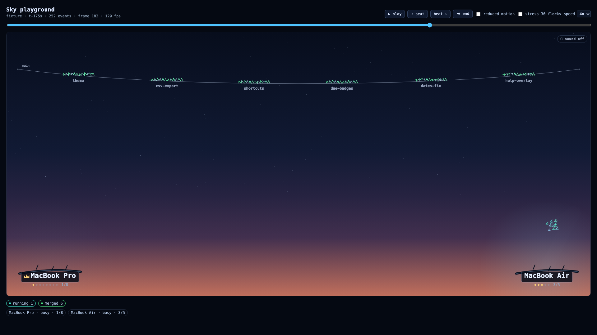
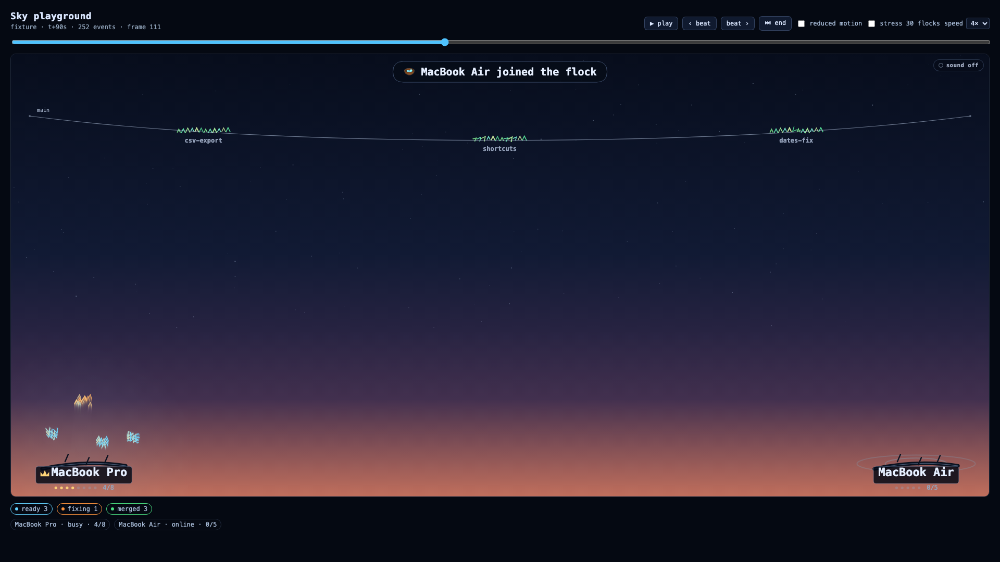

# Epic 47 — Sky polish: roosts, migrations, sound

## Goal

Make the Sky the thing a judge remembers. Epic 24 shipped a working murmuration; the C1 projector
review found three things to fix: roost labels were a few pixels tall, the bottom of the sky went
empty once birds left their roosts, and a laptop joining the flock was almost invisible. This epic
makes the flock legible from the back of a room, gives the join/leave/migration beats a performance,
shows birds *working* (sparks on file edits, a beat on every tool call), labels the wire in merge
order, and adds an optional, entirely synthesised soundscape.




The two screenshots are 1920×1080 captures of the Playground at t+175 s (mid-run) and t+90 s (the
Air joining). Both are under 210 KB.

## How it works

```
StarlingEvent[] ──► SkySimulation.setInput()
                     │  syncRoosts       join/leave → grow, dim, ripple, busy, captions
                     │  collectEvents    node.* → notices (back-dated), task.migrated → arc
                     │  syncFlocks       status → behaviour, landing order, sweep trigger
                     │  collectCues      file.edited → sparks, tool.call → beat
                     ▼
                   step(dt) ──► roost animation + flock choreography + sparks + sweep
                     │
                     ▼
                   render.ts ──► roost plates + gauges, ripples, wire labels, shimmer,
                                  sweep crest, sparks, beat rings, toast captions
                     │
                     └──► drainAudioCues() ──► sound.ts (WebAudio chirp/whoosh/hum)
```

| File | Role |
|---|---|
| `layout.ts` | Roost geometry now also carries `activeSessions`, `maxSessions`, `isHub`, `busy`, `ripple`, `left`, plus `roostLabelFont(height)` and the label/gauge baselines. |
| `cues.ts` | Fixed-size spark pool (`Float32Array` ring buffer), caption copy and the fade envelope. |
| `sim.ts` | Join/leave detection, back-dated notices, sparks/beats, merged landing order, the all-landed sweep, `drainAudioCues()`, `workingFraction()`. |
| `render.ts` | Projector roost plates (name + crown + session pips/`3/5`), busy glow, ripples, leave caption, wire task keys, landing shimmer, sweep crest, sparks, beat rings, toast row. |
| `sound.ts` | `readSoundEnabled`/`writeSoundEnabled` (throw-proof), `createSkyAudio()` — hum + chirp + whoosh, no assets. |
| `SkyView.tsx` | Feature-detects `paused`/`onFps`, feeds the sound engine from sim cues, renders the sound toggle. |
| `Playground.tsx` / `preview.tsx` | fps readout, "stress 30 flocks" toggle (`?stress=1`), screenshots. |
| `replay.ts` | `withStressTasks()` for the 360-bird measurement. |

### Roosts (readable at 1920, fine at 720)

- Roosts sit `ROOST_LIFT` (84 px) above the bottom edge so the plate and gauge are inside the
  canvas. Before, the label baseline landed exactly on the bottom pixel row and was effectively
  clipped.
- The name is drawn at `clamp(15, height × 0.026, 24)` px: **21 px on the shell's 816 px-tall sky at
  1080p**, 18 px at 720p, never below 15 px. Long names are ellipsised to the roost width.
- Each roost has a dark glass plate, a hand-drawn gold crown for the hub (`id === 'hub'`), and a
  sessions gauge: one pip per `maxSessions` (lit up to `activeSessions`) plus a literal `3/5`.
- A soft cyan radial glow scales with `activeSessions / maxSessions` — "gentle" means it never
  competes with the birds.

### Join, leave, migration

- `node.joined` starts a roost at `grow = 0` (it rises 46 px out of the horizon, plate included) with
  a two-ring ripple that fades over `RIPPLE_LIFE` (1.7 s), and a top-centre toast:
  `🪺 MacBook Air joined the flock`.
- `node.left` dims the roost to 0.25, scatters its flocks, and draws `MacBook Air has flown away`
  under the roost, fading over 3.8 s.
- Both are driven by the actual events (not by diffing the node list), deduplicated by
  `(type, nodeId, ts)` and **back-dated** by `now − event.ts`. A replay frame that lands nine seconds
  after the join therefore shows a settled roost, not a fresh toast replaying forever.
- Migration is still the 3.4 s quadratic arc with a comet trail, but the arc now *ends* in the
  destination roost's working band, so the flock visibly reforms where it will work.

### Work cues

- Working flocks (`running`, `auditing`, `fixing`, `conflict`) loop in a band anchored to **their own
  roost** (roughly 60–75 % of the sky height), instead of the canvas middle. With a hub on the left
  and a perch on the right, the bottom half of the sky is now the place work happens — the original
  C1 complaint.
- `file.edited` → four warm sparks at the flock leader (pooled, 0.8 s life, deterministic via the
  seed).
- `tool.call` → `flock.beat = 1`, a ring that expands and fades in ~0.4 s. Audits circle amber and
  fixes keep the wider, faster coral zig-zag.
- Cues are only emitted for events newer than the last one seen for that task, so a prop re-render
  never doubles a spark burst.

### The wire

- Slots are now spaced by the number of **landed or landing** flocks, not every task in the plan. Nine
  landed flocks get nine readable positions instead of bunching into the left third.
- Each landed flock draws its task key under the wire (ellipsised to the slot). The first 1.5 s after
  a real landing adds a shimmer ring and a flash behind the key; a flock that was *born* merged on a
  reconnect (`landedSeq === 0`) does not shimmer.
- Staggered lift + a crest travelling along the wire when `run.status === 'finished'`, plus an
  `All 7 birds landed` caption. Fired exactly once per run (`sweepSeen`).

### Sound (off by default)

- `readSoundEnabled()` / `writeSoundEnabled()` wrap `localStorage` in try/catch and take an injected
  `StorageLike`; a blocked/private-mode store simply forgets the preference.
- `createSkyAudio()` synthesises everything with WebAudio: two detuned sine oscillators (54 + 81 Hz)
  for the hum, a pitch-ramped chirp on each landing, a downward `triangle` sweep for a migration.
  `setHum()` gets `workingFraction()` every 250 ms.
- The toggle lives in the Sky's top-right corner (`aria-pressed`, "sound on/off"). Turning it on
  creates/resumes the context from the click gesture; a persisted "on" waits for the next
  pointer/key event before resuming.

### Paused, fps, stress

- `paused` stops the rAF loop (no scheduling, one last draw) and resumes with a fresh timestamp, so
  time does not jump. It is an **optional local prop** because Epic 40 adds it to core in parallel.
- `onFps` feeds the Playground's live `NNN fps` readout; the Sky also keeps `data-fps` on its wrapper.
- "stress 30 flocks" / `?stress=1` inflates the frame to 30 flocks (360 birds) for the measurement.

## Key decisions & reasoning

- **Roost-anchored work bands, not a global mid-sky orbit.** The original murmur target was `0.4 ×
  height` for every flock, which emptied the bottom of the sky as soon as the roosts cleared and told
  you nothing about *which machine* was running a task. Bands are clamped so a seven-flock crowd on
  one roost still fits.
- **Event-driven join/leave with back-dating.** Diffing `NodeInfo[]` alone cannot tell a replay where
  a join happened in time; using the event timestamp (and subtracting the frame's age) makes ripples
  and captions correct for live SSE *and* for scrubbing.
- **Dynamic wire slots.** Epic 24 spaced slots by total task count for stability. That was unreadable
  with 9+ merges (labels overprinted). Spacing by landed count makes merge order legible; the cost is
  that landed flocks slide left when a new one arrives, which reads as the wire filling up.
- **Cues are sim state, not renderer polling.** Sparks/beats live in the sim so they are deterministic
  (seeded), testable without a canvas, and cost nothing when muted.
- **Sound helpers are pure and injected.** `createSkyAudio({ createContext })` lets the tests prove
  the hum/chirp/whoosh are scheduled without an audio device, and keeps the module inert in SSR.
- **No audio files, no asset pipeline.** All three sounds are a handful of oscillators; nothing to
  ship or cache.
- **Local optional props (`paused`, `onFps`, `createAudio`).** Core belongs to Epic 40 this wave
  (L30). The intersection type keeps working when core adds `paused`; no coordinated change needed.
- **Calm mode snaps the chrome.** Reduced motion never steps the sim, so a new roost would sit at
  `grow = 0` forever. `layoutCalm()` settles `grow`/`dim`/`busy` and skips ripples, sparks, beats,
  shimmers and the sweep: the calm view is a static status map.
- **A fixed spark pool.** 192 slots in five `Float32Array`s, overwritten round-robin. No allocation in
  the hot loop and no unbounded growth under a chatty agent.

## Performance

Measured on the M5 Pro worktree, 1920×1080 Playground, `?stress=1` (30 flocks / 360 birds + the
fixture's merged birds):

- `requestAnimationFrame` readout (`data-fps`, shown in the Playground header): **119–121 fps** in
  headless Chromium (the display caps at 120 Hz; the Sky never dropped below it).
- Pure sim cost, 30 flocks / 360 birds, 1440×900, 600 steps: **22.8 ms total, 0.038 ms/step** — about
  0.2 % of a 16.7 ms frame. The `performance` test in `sim.test.ts` keeps the 600-step budget honest.

## Interfaces for future epics

```ts
// SkyView — core's SkyViewProps plus three optional locals (see FIX REQUEST 1)
type SkyViewProps = CoreSkyViewProps & {
  paused?: boolean;                 // stop the loop / resume without a time jump
  onFps?(fps: number): void;
  createAudio?(): SkyAudio;         // test / embedding seam
};

// Sim additions
sim.drainAudioCues(): { landings: number; migrations: number; joins: number; leaves: number };
sim.workingFraction(): number;      // 0..1, drives the hum
sim.sweepProgress(): number;        // -1 idle, 0..1 through the all-landed wave
sim.notices: RoostNotice[];         // joined | left | finished, back-dated
sim.sparks: SparkPool;              // MAX_SPARKS ring buffer

// Roost geometry now exposes the chrome state
interface Roost { /* … */ busy: number; activeSessions: number; maxSessions: number;
  isHub: boolean; ripple: number; left: number }
roostLabelFont(height: number): number;

// Sound (pure helpers + engine)
readSoundEnabled(storage?): boolean; writeSoundEnabled(on, storage?): void;
createSkyAudio({ createContext? }): SkyAudio; // enabled, setEnabled, cue, setHum, resume, dispose

// Playground / demos
<Playground initialStress />;       // or preview.html?stress=1
withStressTasks(run, nodes, count?): Run | undefined;
```

The shell can pass `paused={view !== 'sky'}` as soon as it likes; nothing else is needed. The
per-feature props contract is otherwise unchanged.

## Deviations from plan

- **`paused` is local, not core.** The prompt said it is "coming (Epic 40)"; this lane feature-detects
  it rather than waiting, and filed a FIX REQUEST to add it to `@starling/core`.
- **Dynamic wire slots** change an Epic 24 decision (see above); the old behaviour is described in
  `docs/epic-24-web-sky.md` and is intentionally superseded.
- **A leave caption is drawn at the roost, not as a top toast.** A toast that points at a roost on
  the far right is easy to miss; the local caption plus the dimmed roost tells the story in place.
  Joins and the all-landed line use the top toast row.
- **Sound is a pitch sweep, not filtered noise.** A noise buffer for the whoosh would have meant an
  extra allocation and a filter graph for a 0.5 s cue; the sweep is cheaper and reads as air moving.
- **Extra test seam `createAudio`.** Not needed by the dashboard, but it lets the unit tests assert
  the toggle's persistence without an audio device or module mocking.
- **`withStressTasks` and the stress toggle** are additions (not in the deliverable list) so the
  360-bird / 60 fps claim can be reproduced by a reviewer in one click.

## Known limitations / deferred

- **No pixel-diff tests.** happy-dom has no 2D context; the network of deterministic sim tests plus
  the committed screenshots is the safety net. A Playwright pixel harness is a good next step.
- **Sound is verified with a fake context**, not on speakers. The oscillator graph is asserted; the
  mix is not. No volume slider; the master is fixed at 0.26.
- **Audio starts only after a gesture** (browser autoplay policy). A viewer with a persisted "on"
  hears nothing until their next click or keypress — by design, documented in the toggle's title.
- **Captions are English-only** and capped at four at a time; a burst of node churn keeps the newest.
- **Calm mode freezes captions** (`simTime` does not advance), so a join in reduced motion shows a
  settled roost and no toast. Correct for "static", but a reviewer may expect the text.
- **One migration arc per flock.** A flock re-migrating mid-arc loses its old trail; duration is still
  fixed at 3.4 s regardless of distance.
- **Wire keys are ellipsised** once a run merges more than ~30 tasks; the DAG panel remains the place
  for full task titles.
- **The shell does not pass `paused` yet.** Epic 40/41 own the view switch; the Sky already handles it,
  and the unit test drives the prop directly.
- **No live test file.** Everything here is deterministic, DOM-only and asset-free; no network, no
  LLM, no opencode.
